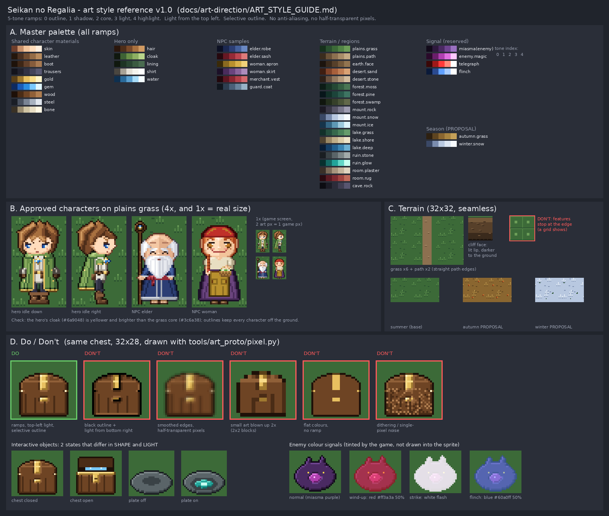

# 星環のレガリア　絵のスタイルガイド（v1.0 用）

この文書は、v1.0 の絵を作る人と、絵の統一感を確認する人（デザイン確認係）が使う「共通の決まり」です。
基準は、**承認ずみの主人公の本番の絵**（`src/art-release/hero/`）と、**提出ずみの村人の本番の絵**（ブランチ `feature/npc-release-batch2-fix` の `src/art-release/npc/`）です。
色の値は、その絵を作ったプログラムの色（`tools/art_proto/pixel.py`、`tools/hero_release/gen_hero.py`、`tools/npc_release/*.py`）からそのまま取りました。

- 見本の画像：`docs/art-direction/style_reference.png`（作り方：`python3 tools/art_direction/style_reference.py`）
- 大きさと名前の一覧：`docs/ART.md`、`docs/art-kit/LIST.md`（266 枚）
- 世界と地方：`docs/DESIGN.md` 5 章

「**案**」と書いた所は、まだ人の承認を待っています。承認までは、その方法で本番の絵を作り切らないでください。

---

## 1. 全体の決まり

### 1.1 一番大事な 8 つ

| # | 決まり | 中身 |
|---|---|---|
| 1 | **5 段階の色** | 1 つの素材（肌・革・木など）は 5 色で塗る。0＝輪郭、1＝影、2＝基本、3＝明るい面、4＝一番明るい点 |
| 2 | **光は左上から** | 上と左を向いた面が明るい（3〜4）。下と右を向いた面が暗い（1）。全部の絵で同じ |
| 3 | **選んで付ける輪郭** | 外側の輪郭は、接している素材の 0 番の色（一番暗い色）。黒一色の線は使わない |
| 4 | **ぼかし禁止** | なめらかにする処理（アンチエイリアス）をしない。半透明の点を置かない。点は「完全に不透明」か「完全に透明」だけ |
| 5 | **背景は透明** | PNG。絵の外は透明（アルファ 0） |
| 6 | **最初からこの細かさで描く** | 絵 2 ドット＝ゲーム内 1 ドット。小さい絵を拡大しただけのものは完成品にしない |
| 7 | **焼き込まない** | 夜の暗さ、天候、ダメージの点滅、溜めの赤い光は、プログラムが色を付ける。絵は「晴れた昼」の色で描く |
| 8 | **決まった色だけ** | 下の 2 章の色（ランプ）から選ぶ。新しい素材は、新しい 5 色のランプを作って 2 章に足してから使う |

### 1.2 5 段階の色の使い方

| 番号 | 名前 | どこに使うか | 量の目安 |
|---|---|---|---|
| 0 | 輪郭 | 外側の縁、深いすき間、口や鼻の穴 | 縁の 1 ドット幅だけ |
| 1 | 影 | 下と右を向いた面、重なりの下 | 面積の 2〜3 割 |
| 2 | 基本 | 素材のいちばん広い面 | 面積の 4〜5 割 |
| 3 | 明るい面 | 上と左を向いた面 | 面積の 2 割 |
| 4 | 一番明るい点 | 左上の角、金属・宝石・髪のつや | 点で少しだけ（光る素材だけ多めに） |

- 光る素材（髪・宝石・金・鋼・ひげ）は、左上の角に 4 番を置く。布や肌は 3 番まで（`pixel.py` の `SHINY`）
- 正面と背面の絵は、左半分を描いて反転してよい。そのとき**右半分は 1 段暗くする**（4→3、3→2）。光は左のまま（村人の作り方 `npc_common.py`）
- 奥の手足や奥の物は、1 段暗くする

### 1.3 輪郭

- 外側の輪郭は 1 ドット。色は「その縁で接している素材の 0 番」。肌の縁は肌の 0 番（`#6e3e2c`）、マントの縁はマントの 0 番（`#10180e`）
- 2 つの素材の境目には線を引かない。色の段の違いで分ける（影の 1 番を境に置く程度）
- 地面の絵（地面・水・床）には輪郭を付けない。輪郭があると、並べたときにマス目が見える

### 1.4 どこまで細かく描くか（ゲーム内 16×28 で見たとき）

主人公は絵では 32×56、ゲーム画面ではゲーム内 16×28 の大きさです。iPhone の横画面で、主人公は指 1 本ぶんくらいの大きさです。

| してよい | しない |
|---|---|
| 目は 2×2〜3×3 ドット（瞳・光の点を入れてよい） | 1 ドットだけの模様を散らす（汚れに見える） |
| 細い部品（杖・ひも）は 1〜2 ドット幅、輪郭込みで 3 ドット | 1 ドット幅の線を輪郭なしで地面の上に出す（消える） |
| 刺しゅう・模様は 2 ドット以上のまとまりで | 市松模様の点描（ディザ）で色を混ぜる |
| 顔の向き・持ち物・服の色の塊で人物を見分ける | 小さい違い（ボタンの数など）だけで人物を見分ける |

- **見分けテスト**：絵を黒一色のシルエットにしても、何なのかが分かること（主人公は「マント」と「胸の光」）
- 実際の大きさ（1 倍）でも見ること。見本の B 欄の右に 1 倍の絵がある

---

## 2. 色の一覧（マスターパレット）

### 2.1 キャラクターで共通の素材（`pixel.py` の `BASE_RAMPS`）

0（輪郭）→ 4（一番明るい）の順です。

| 素材 | 0 | 1 | 2 | 3 | 4 |
|---|---|---|---|---|---|
| skin 肌 | `#6e3e2c` | `#c8906a` | `#f2c49b` | `#ffdcbc` | `#fff0e0` |
| leather 革 | `#24160c` | `#4a3020` | `#704c30` | `#946c46` | `#b88c5e` |
| boot 長靴 | `#1e120a` | `#3e2616` | `#62402a` | `#865c3c` | `#a87a52` |
| trousers ズボン | `#14141c` | `#22222e` | `#323244` | `#44445a` | `#585872` |
| gold 金 | `#5a4018` | `#a07a30` | `#e8c060` | `#f8dc88` | `#fff4c8` |
| gem 宝石（青） | `#0e2a60` | `#1a5cb8` | `#2a8de2` | `#78c8ff` | `#e0f6ff` |
| wood 木 | `#1e1008` | `#4a2c16` | `#6e4424` | `#906038` | `#b07e50` |
| steel 鋼 | `#1a1e26` | `#4a5260` | `#7a8494` | `#a8b2c0` | `#e0e6ee` |
| bone 骨 | `#3a3226` | `#9a8c70` | `#d0c4a4` | `#e8dec4` | `#fff8e4` |

- 肌は人物ごとに少しずらしてよい（老人 `#e2ae8a`、鍛冶屋 `#d49a72` など）。色合いは変えず、明るさだけ
- 鉄（衛兵・鍛冶屋の `iron`）：`#14161c` `#40464f` `#6c7480` `#9aa2ae` `#d4dae2`

### 2.2 主人公だけの色（`gen_hero.py` の `RAMPS`）

| 素材 | 0 | 1 | 2 | 3 | 4 |
|---|---|---|---|---|---|
| hair 髪（茶） | `#2a160c` | `#4e2e1a` | `#7a4a2a` | `#a8703f` | `#d09a62` |
| cloak マント（黄みの緑） | `#10180e` | `#3e6234` | `#6a9048` | `#8eb062` | `#b8d48a` |
| lining マントの裏 | `#10180e` | `#1e3424` | `#2a4632` | `#3a5a40` | `#4a6c50` |
| shirt シャツ（白） | `#4a4640` | `#a8a296` | `#e4e0d6` | `#f6f4ee` | `#ffffff` |
| water 水しぶき | `#0e3050` | `#2a6a9a` | `#5aa0d0` | `#a8dcf8` | `#f4fcff` |

目：まつげ `#24223a`、瞳 `#2a78d0`、瞳の影 `#1a3c86`、光 `#f0fbff`。口 `#a8584e`、ほお `#f0a888`。

### 2.3 主人公の「目印の色」を守る

主人公は **緑のマント・白いシャツ・金・青く光るペンダント** で見分けます。ほかの絵は次を守ります。

| 色 | 主人公以外での使い方 |
|---|---|
| 黄みの緑（マント `#6a9048` 付近） | 人物・敵の**服の大きな面**に使わない。草・葉・地面には使ってよいが、地面の緑はマントより**暗く青み寄り**にする（2.5） |
| 光る青（宝石 `#2a8de2`、光 `#78c8ff`〜`#e0f6ff`） | 小さな点ならよい（老人の杖の宝石、宝箱の中身）。**大きく光る青**は主人公と星環だけ |
| 金 `#e8c060` | 小物・飾り・留め具ならよい。服の大きな面には使わない |
| 白 `#e4e0d6`〜`#ffffff` | 服に使ってよい（料理人・商人）。ただし白い服＋緑の上着の組み合わせは使わない |

### 2.4 村人の色（見本。`tools/npc_release/*.py`）

村人は「**落ち着いた暖色＋紺**」です。どの人も主人公の緑を避けています。

| 人物 | 主な色（2 番＝基本色） |
|---|---|
| 老人 | 衣 紺 `#2c3e74`、帯 えんじ `#962a36`、髪 白灰 `#cdd0da` |
| 村の女性 | エプロン 黄土 `#b8902e`、スカート 紫 `#6a447e`、ブラウス 生成り `#e8dec2`、頭巾 赤 `#c0302a` |
| 子ども | シャツ 空色 `#5aa2d0`、髪 金 `#d8aa40` |
| 料理人 | シャツ 赤茶 `#984228`、エプロン 白 `#e2e0da` |
| 衛兵 | 上着 灰青 `#4a6078`、鉄 `#6c7480` |
| 商人 | ベスト えんじ `#8a2632`、ズボン 金茶 `#986a28` |
| 鍛冶屋 | シャツ 灰 `#6c727c`、前かけ こげ茶 `#583418`、髪 赤 `#b03a1a` |

新しい人物も、この幅の中から選びます。**紫は村人の服なら少しよいが、光る紫・赤紫は敵だけ**（2.6）。

### 2.5 地方ごとの色（地面・地形）

見本の A 欄「Terrain / regions」と同じ値です（`style_reference.py` の `REGION`）。地面は輪郭なしで、主に 1〜3 番を使います。

> **この表の値はまだ仮です。** 地方ごとの本番の色は、地形担当が直した色の表（デザイン確認係の指摘を直したもの）を、次の確認で合格したあとに、この表へ書き写して確定します。それまで新しい値をここで作り足しません。下の「決まり」（明るさの差・黄緑の地面なし・遺跡は青緑・澱の紫は地面に使わない）は、値が変わってもそのまま守ります。

| 地方・場所 | 素材 | 0 | 1 | 2 | 3 | 4 |
|---|---|---|---|---|---|---|
| 草原・はじまりの島 | 草 plains.grass | `#16301c` | `#2a5030` | `#3c6a38` | `#528446` | `#6c9e58` |
| 〃 | 道 plains.path | `#3a2c1e` | `#6a5238` | `#8c7050` | `#a88c68` | `#c4aa84` |
| 〃（崖） | 土の崖 earth.face | `#1c140e` | `#3a2a1c` | `#57402a` | `#74583a` | `#927450` |
| 赤砂の荒野 | 赤い砂 desert.sand | `#3e1e12` | `#82442a` | `#a8603c` | `#c27e54` | `#daa274` |
| 〃 | 砂岩 desert.stone | `#2e2018` | `#6a5240` | `#947a60` | `#b49a7c` | `#d2bc9e` |
| 囁きの森 | 苔 forest.moss | `#0c1c16` | `#183426` | `#244834` | `#345e42` | `#4a7654` |
| 〃 | 針葉樹 forest.pine | `#08161a` | `#123028` | `#1c443a` | `#2a5a4c` | `#3e7462` |
| 〃 | 沼 forest.swamp | `#10160e` | `#232e1c` | `#36402a` | `#4a5438` | `#62684a` |
| 白嶺山脈 | 岩（灰紫） mount.rock | `#1c1a24` | `#3a3846` | `#585668` | `#7a788c` | `#9e9cb0` |
| 〃 | 雪（影は青） mount.snow | `#3a4866` | `#7a8cae` | `#b8c8e0` | `#dce6f2` | `#f8fbff` |
| 〃 | 氷 mount.ice | `#16344a` | `#346684` | `#5e98b4` | `#9cc8dc` | `#dcf2fa` |
| 鏡湖と群島 | 岸の草（青緑） lake.grass | `#12302a` | `#244e3e` | `#36684c` | `#4a825a` | `#669c6c` |
| 〃 | 浜 lake.shore | `#4e4230` | `#9a8866` | `#c0ae88` | `#d8caa6` | `#eee4c8` |
| 〃 | 深い水 lake.deep | `#081c34` | `#143e66` | `#22608e` | `#3a84b2` | `#6aaed2` |
| 〃 | 浅い水 | 濃い青（2 番 `#2d6aa8` の系統）。5 段の値は地形担当の表から登録する（3.5） | | | | |
| 遺跡（灯の民） | 石 ruin.stone | `#1a1e22` | `#3a4246` | `#5a6468` | `#7c8688` | `#a2aaaa` |
| 〃 | 遺跡の光（青緑） ruin.glow | `#08302e` | `#146a64` | `#22a49a` | `#62d6c6` | `#c6fff0` |
| 家の中 | しっくい room.plaster | `#3a3028` | `#7a6a58` | `#a8967e` | `#c4b49c` | `#e0d4c0` |
| 〃 | 床 | 木 wood（2.1） | | | | |
| 〃 | じゅうたん room.rug | `#2a0a10` | `#5a1a22` | `#7e2a30` | `#a04440` | `#c06a5a` |
| 地底（まだ絵の一覧に無い） | 洞窟の岩 cave.rock | `#0c0c12` | `#1c1c26` | `#2c2c3a` | `#403e52` | `#585670` |

**主人公とぶつからないための決まり**

- 地面の 2 番（いちばん広い色）は、マントの 2 番 `#6a9048` と比べて、**明るさが 12 以上違う**か、**色合いがはっきり違う**こと（明るさ＝0.299R＋0.587G＋0.114B を 0〜100 にした値。マントは 49）
- **明るさの決まりは、絵（PNG）そのものの色で測る**。ゲームの中で付く色（平地を暗くする・高い所を明るくする・夜・天候・点滅）を足した後の色では測らない。ゲームのしくみが変わっても絵の決まりが崩れないようにするため。この文書の明るさの決まり（2.5、5.4、7 章）は全部これで測る
  - 草原の草 34、森の苔 23、岸の草 34：暗い緑で OK
  - 赤い砂 44、道 46：明るさは近いが、色合い（赤茶）が違うので OK
  - 雪 78：明るい。主人公の輪郭で浮くので OK
- 地面の緑は、マントより**暗く、青み寄り**にする。黄緑の地面は作らない
- 遺跡の光は**青緑**（`#22a49a`）。主人公の青（`#2a8de2`）とは色合いを分ける
- 澱（敵）の紫・赤紫は、地面や建物に使わない（澱に侵された場所の表現は「決めてほしいこと」）

### 2.6 意味が決まっている色（合図の色）

| 名前 | 色 | 使ってよい物 |
|---|---|---|
| 澱（おり）の紫 miasma | `#120a1a` `#2e1a3e` `#4a2a62` `#6e4490` `#9a70c0` | 澱の魔物の体、澱の霧 |
| 敵の魔法 enemy.magic | `#2a0a2a` `#6a1e6a` `#b040b0` `#e070e0` `#ffc8ff` | 敵の弾・呪い・敵の杖の光 |
| 溜め（危険） telegraph | `#3a0808` `#a01818` `#ff3a3a` `#ff8a7a` `#ffffff` | 敵の攻撃の予兆だけ（プログラムの点滅、地面の危険範囲） |
| ひるみ flinch | `#0a1a3a` `#2a4a90` `#60a0ff` `#a8ccff` `#ffffff` | 敵がひるんだ時の点滅だけ |

- 純粋な赤 `#ff3a3a` 付近は「危ない」の意味。敵の体の大きな面に使わない（溜めの赤が見えなくなる）
- 敵の目は黄色（`#ffd84a` / `#fff2a8` / `#b06a10`、獣の試作と同じ）でよい

---

## 3. 地形のマス

### 3.1 大きさと名前

| 種類 | 大きさ | 基準点 | 例 |
|---|---|---|---|
| 地面・水・床 | **32×32**（変えられない） | 左上 | `tile.grass.0` `plains.grass.0〜3` `tile.water.0〜1` |
| 坂 | 32×64（変えられない） | 左上 | `tile.ramp` |
| 崖の側面 | 32×8（高さ 4）／32×16（高さ 8）（変えられない） | 左上 | `face.<earth/stone/ruin/wall>.<top/mid/top-base/mid-base>.<4/8>` |

大きさが違うファイルはゲームに使われません（仮の絵のまま）。

### 3.2 地面をつなぎ目なく並べる

- **輪郭を付けない**
- 草の束・小石などの模様は、上下左右の端をまたいでよい。ただし**またいだ分は反対側の端に続ける**（ぐるっと一周つながる絵として描く）。描いたら 3×3 に並べて見る
- 端だけ明るい・暗い、という塗り方をしない（見本 C 欄の「DON'T」はマス目が見える例）
- 明るさの差は小さく：主に 1〜3 番。4 番は全体の 3% 以下
- 模様の大きさは 2〜5 ドットのまとまり。1 ドットだけの点を散らさない
- 地面はキャラクターより**静か**に：キャラクターより色数を少なく、明暗の差を小さく

### 3.3 種類違い（変化を付ける）

- 1 つの地面に 2〜4 枚（一覧どおり：`plains.grass.0〜3` など）
- **0 番がいちばん地味**（いちばん多く並ぶ）。1 番以降で花・小石・草の束を足す
- 色の土台（2 番の面）は全部の種類で同じ。違うのは小物の置き場所だけ（8 割は同じ絵）
- 目立つ物（花・大きな石）は、1 枚に 1 つまで。並べたときに同じ物が規則的に見えないこと

### 3.4 崖の側面（`face.*`）

崖の側面は南（下）を向いていて、光は左上から来るので、**上の地面より 1 段暗い**のが基本です。

| 部分 | 塗り方 |
|---|---|
| `top`（崖の上の縁） | いちばん上の 1〜2 ドットは**上の地面の色**（草の縁）。その下 1 ドットを 3 番（縁が光を受ける） |
| `mid`（途中） | 2 番が中心。地層・石は「上側 3 番、下側 1 番」 |
| `*-base`（地面に接する段） | 下に行くほど 1 番。いちばん下の 1 ドットは 0 番（地面との境目） |
| 高い崖 | 上 → 下へ 3 → 2 → 1 番と暗くなる。高い所ほど明るい |

- `.4` と `.8` は同じ崖の高さ違い。模様を合わせて、縦に重ねてもつながること
- 左右の端もつながること（横に何枚も並ぶ）
- 素材：草原は土（earth.face）、山は岩（mount.rock）、遺跡は遺跡の石、家の中は壁（しっくい＋木）

### 3.5 水

- 浅い水は**濃い青**（2 番 `#2d6aa8` の系統。地形担当の案）。深い水は lake.deep
- 明るい水色（`water`：`#5aa0d0` `#a8dcf8` `#f4fcff`）は**主人公の水しぶきの色**。水のマスの広い面には使わない（泳いでいる時の水しぶきが見えなくなるため）。水のマスでは、波の光の点だけに使ってよい
- 2 コマ（`tile.water.0` `.1`）で、明るい波の山だけを少し動かす。光の粒と暗い筋は両方のコマで同じ位置。コマの違いは 1 マスで **12〜30 ドット**（多いと広い湖でちらつく）
- 岸の線：今は水と岸のつなぎのマスが無いので、水のマスの中に岸を描かない。つなぎのマス（水と岸だけ）を足すかは「決めてほしいこと」。足した場合は、地面側に 1 番の影を 1 ドット、水側に 4 番の泡を 2〜3 ドットのまとまりで
- 水の上でも主人公の輪郭とマントが見えること

### 3.6 道の端

- 今の絵の一覧には「草と道の境目専用のマス」がありません
- `tile.path` は縦・横・十字に並ぶので、**1 枚の中に草のかぶりを描かない**（描くと道の中に草の筋が出る）。道の絵はマス全体を道にして、草とのさかい目は**まっすぐ**でよい（見本 C 欄）
- 道の中の小石は 2〜3 ドットのまとまりを 1〜2 個。1 ドットの小石を散らさない。4×4 に並べて格子に見えないこと
- 道と草のつなぎのマスは作らない方向（おすすめ）。つなぎのマスは水と岸だけを「決めてほしいこと」にしてある

### 3.7 四季（**案。人の承認待ち**）

| 季節 | 方法（案） |
|---|---|
| 夏 | 季節なしの元の絵 |
| 春 | 元の絵のまま＋花を手描きで足す（`spring.obj.tree` は花の木） |
| 秋 | 草のランプを秋の色に置き換える（`#2e2010` `#5e4420` `#8a6630` `#a88440` `#c4a058`）＋落ち葉（`#5a1a0a` `#c0461c` `#f08a3a`）を手描きで足す |
| 冬 | 草のランプを雪のランプ（mount.snow）に置き換える＋雪から出ている草・木の上の雪を手描きで足す |

- 「色の置き換え」は 5 段の番号どうしで行う（2 番→2 番）。形は同じなので、季節で絵がずれない
- 置き換えだけでは単調なので、**必ず手描きの足し物**（落ち葉・雪の盛り上がり）を入れる
- 秋の草は、主人公のマントと色合いがぶつからない（黄土色）。冬の雪は明るいが、主人公の輪郭で浮く
- 見本 C 欄の下に、夏・秋（案）・冬（案）の例がある

---

## 4. 物と建物

### 4.1 基準点・輪郭・大きさ

- 基準点は**足元**（絵の下の真ん中が地面に立つ位置）。下の行に影の 0 番を置き、地面に置いた感じを出す
- 輪郭はキャラクターと同じ 1 ドット・選んで付ける輪郭
- 物の上面は明るく（3 番）、手前の面（南向き）は 2 番、右の面は 1 番

| 物 | 絵の大きさ（目安） | 主人公 32×56 と比べて |
|---|---|---|
| 宝箱 `obj.chest.*` | 32×28 | ひざ〜腰 |
| 壺 `obj.jar`・木箱 `obj.crate` | 仮の絵の 2 倍 | ひざ〜腰 |
| 机・カウンター | 仮の絵の 2 倍 | 腰 |
| 棚 | 仮の絵の 2 倍 | 頭くらい |
| 木 `obj.tree` | 32×56 前後（森の針葉樹は 32×60） | 主人公より高い |
| 扉 `obj.door` | 高さ **64 以上** | 主人公より高い |
| 家 `obj.house` | 幅 96、高さ 112 前後 | 扉＋屋根 |
| かがり火・燭台 | 24×32 前後 | 腰〜胸 |
| 結晶 `obj.crystal` | 24×36 | 胸 |

### 4.2 触れる物（宝箱・スイッチなど）

触れる物は、2 コマ（`off`/`on`、`closed`/`open`、`.0`/`.1`）で状態が分かることが大事です。

- **形と光の 2 つを変える**：形（ふたが開く・板が沈む）だけ、色だけ、にしない（見本 D 欄の下）
- 形の違いは 6 ドット以上
- 「動いている・使える」状態は光る色を入れる。遺跡の仕掛けは遺跡の光（青緑）、火は火の色
- 背景の物（岩・草・柵）より**少し明るく、輪郭をはっきり**させる。触れない物と見分けられること
- 宝箱の金具は金（gold）。開いた中身の光は小さな点だけ

---

## 5. 敵とボス

### 5.1 主人公・村人・敵を色で分ける

| | 色の決まり |
|---|---|
| 主人公 | 黄みの緑・白・金・光る青（2.3） |
| 村人 | 落ち着いた暖色と紺。光る色は持たない（小物の点を除く） |
| 敵（獣・野盗） | くすんだ灰・茶・暗い緑（ゴブリンの肌 `#5e6232`）。目は黄色 |
| 敵（澱の魔物） | 澱の紫（2.6）＋敵の魔法の赤紫の光 |
| 敵（古代機械） | 遺跡の石＋**光は赤紫か赤**（遺跡の仕掛けの青緑と分ける） |

- **色違いだけで種類を増やさない**（形・体格・顔・動きで分ける。`P12_NPC_ENEMY_PLAN.md` と同じ）
- 敵の体の大きな面に、主人公の黄緑・溜めの赤・ひるみの青を使わない

### 5.2 シルエット

- 黒一色にしても種類が分かる：耳・角・尾・武器の形をはっきり外に出す
- ふつうの敵は正面より**横向きで描く**（今の敵は右向き 1 方向、左は反転）
- **ボスは例外で、正面 1 方向でよい**（左右対称の大きな体。反転しない）
- 攻撃する部分（牙・爪・武器）は、体より明るい色か、外に出た形にする

### 5.3 大きさ

| 種類 | 絵の大きさ | 主人公と比べて |
|---|---|---|
| 獣 | 32×26〜44×32（全部のコマで同じ枠） | 腰〜胸 |
| 人型の敵（弓兵） | 32×56（主人公と同じ枠）。ゴブリンは枠の中で 32×44 | 少し低い |
| 番兵（候補） | 40×56（**候補**。人型の枠より幅が広い。承認されたら確定） | 主人公と同じ高さで、肩幅が広い |
| 大型 | 64×72 | 主人公より大きい |
| ボス（核 4 体） | **80〜96 ドット**（幅・高さとも。全部のコマで同じ枠）。**正面 1 方向** | 主人公より 1.5 倍前後高く、**面積で 2 倍以上** |
| 最後のボス（淀みの源） | **128×128 以内** | — |

- 「主人公の 2 倍以上」は**面積**の意味（主人公 32×56 に対して、80×80 なら約 3.6 倍）。高さの 2 倍（112 以上）ではない
- ボスの上限は **128×128**（ゲーム内 64×64＝4×4 マス）。これより大きくする時は「決めてほしいこと」へ

### 5.4 予兆（溜め）の色

予兆の色は**プログラムが付けます**。絵に赤い光を描き込まないでください（見本 D 欄の右下）。構えのコマで見せたい時は、色でなく**形**（玉が大きくなる・結晶が伸びる）で見せます。

**点滅のやり方は 2 つあり、まだ決まっていません**（「決めてほしいこと」）。

| | やり方 | 良い所・困る所 |
|---|---|---|
| A 今のプログラム | 絵の色に `0xff7070` を**掛ける**（`src/view/gameView.js`。ひるみは `0xa8b8ff` を掛ける） | 今のまま動く。ただし暗い体（澱の紫など）は掛けても暗いままで、点滅が見えにくい |
| B このガイドの案 | 赤 `#ff3a3a` を **50% 重ねる**（ひるみは青 `#60a0ff` を 50%） | 暗い体でも赤く見える（見本 D 欄）。プログラムの変更が要るので、人の承認が必要 |

下の表と見本の画像は B の見え方です。A のままになった場合も、絵の決まり（体の 2 番の明るさ 20〜60、赤・青を体の大きな面に使わない）は同じです。

| 合図 | 色 | 見え方 |
|---|---|---|
| 溜め | 赤 `#ff3a3a` を 50% 重ねて点滅（B 案。A なら `0xff7070` を掛ける） | 攻撃の前。体が赤く見える |
| 攻撃の瞬間 | 白 `#ffffff` に近い光（1〜2 コマ） | 「今」と分かる |
| ひるみ | 青 `#60a0ff` を 50% 重ねる（B 案。A なら `0xa8b8ff` を掛ける） | 攻撃が効いた |
| 撃破 | だんだん薄くする | 半透明はプログラムだけ |

- 敵の絵の色は、これらを重ねても見分けられること（明るさは絵そのもので測る）：**体の 2 番の明るさは 20〜60**（澱の紫 23、獣の毛 30、ゴブリンの肌 36）（真っ黒・真っ白に近い体は、赤や白を重ねると分からなくなる）
- 地面に危険範囲を出す時は、赤 `#ff3a3a` の線＋外側に `#3a0808` の縁取り

---

## 6. アイコンと効果

### 6.1 持ち物のアイコン（`icon.*`）

| 決まり | 中身 |
|---|---|
| 大きさ | **20×20** |
| 余白 | 上下左右 1 ドット以上あける（中身は 18×18 まで） |
| 輪郭 | **外側を全部囲む**（暗い画面の上で形が消えないように）。色は素材の 0 番 |
| 色 | 2 章のランプから。1 つのアイコンに素材は 3 つまで |
| 光 | 左上から。4 番を 1〜3 点 |
| 明るさ | 暗い画面（`#20242c` 付近）の上で、中身の 2〜3 番がはっきり見えること。暗い物（肉・牙）は 3 番を多めに |
| 形 | 少し斜め（左下→右上）に置くと、20×20 の中で大きく見える |

### 6.2 効果（`fx.*`）

- 基準点は中心（炎は足元）
- **味方の効果**（剣の軌跡 `fx.slash`、矢、盾 `fx.shield`、滑空）：白・空色・金。主人公の色
- **敵の効果**（光の玉 `fx.orb`）：敵の魔法の赤紫か、溜めの赤
- 炎：`#5a1a0a` `#c0461c` `#f08a3a` `#ffd060` `#fff4c8`（外が暗い赤、芯が明るい黄色）
- 煙・影：灰色の段で塗る。**半透明の点は使わない**（薄く見せたい時はプログラムで全体を薄くする）
- 影 `fx.shadow`：1 色の暗い楕円。透明度はプログラムで付ける
- 1 コマの効果も、輪郭（0 番）で背景から分ける。草の上でも雪の上でも見えること

---

## 7. 確認リスト（デザイン確認係が使う）

1 つずつ「合格／不合格」を付けます。不合格が 1 つでもあれば差し戻しです。

### A. 世界のまとまり

1. 絵の種類・地方に合った色（2.5）になっているか
2. 主人公・承認ずみの村人と並べて、同じゲームの絵に見えるか（見本 B 欄と並べる）
3. 同じ地方の絵どうしで、明るさ・色の強さがそろっているか
4. 季節の絵は、元の絵と形がずれていないか（四季の方法は**案**。承認後に確認）

### B. 色・輪郭・光

5. 1 つの素材が 5 段の色だけで塗られているか（2 章のランプか、2 章に足したランプ）
6. 光が左上から来ているか（上と左の面が明るく、下と右が暗い）
7. 外側の輪郭が「接している素材の 0 番」か（黒一色の線になっていないか）
8. 地面の絵に輪郭が付いていないか
9. 半透明の点・ぼかしが 0 か（アルファは 0 か 255 だけ）
10. 背景が透明か
11. 合図の色（溜めの赤・ひるみの青・澱の紫）を、決めた物以外に使っていないか

### C. 大きさ・細かさ

12. 大きさが一覧（`LIST.md`）どおりか。地面と崖は**ぴったり**
13. 基準点（足元・左上・中心）が正しいか。足元の物は下の真ん中に足があるか
14. 同じ物の全部のコマが同じ枠の大きさか
15. 小さい絵を拡大しただけ（2×2 の点の塊ばかり）になっていないか
16. 主人公 32×56 と比べて、大きさが表（4.1・5.3）どおりか（扉は 64 以上、ボスは 80〜96・正面、最後のボスは 128×128 以内）

### D. 動き

17. コマ数が一覧どおりか（勝手に増やしていない・減らしていない）
18. コマを順に見て、足元・体の位置がぶれていないか（動かすつもりの所だけが動く）
19. 左向きは右向きの反転でよい（主人公・村人と同じ。反転した絵の光が右上になるのは認める）。ただし片手の持ち物が反転で反対の手に移っていないか
20. 2 コマの物（宝箱・スイッチ・かがり火）は、形と光の両方が変わっているか

### E. 他の絵とぶつからないか

21. 地面の 2 番とマントの 2 番の明るさの差が 12 以上、または色合いがはっきり違うか（2.5。**絵そのものの色で測る**。ゲームの中の暗さ・明るさは足さない）
22. 人物・敵の服の大きな面に、主人公の黄緑・大きく光る青を使っていないか
23. 草・砂・雪・水・床の 5 つの地面の上に置いて、輪郭が見えて埋もれないか
24. 敵の体の色に、赤 50%・白・青 50% を重ねても形が分かるか

### F. ゲームの大きさで見て分かるか（16×28）

25. 1 倍の大きさで見て、何の絵か分かるか
26. 黒一色のシルエットでも、何の絵か分かるか
27. 1 ドットだけの点の散らばり・市松模様の点描が無いか
28. 触れる物が、触れない背景の物と見分けられるか
29. アイコンを暗い画面（`#20242c`）の上で見て、形が分かるか

確認の道具：見本の画像（`style_reference.png`）、`?gallery=1`（村の広場に人物と敵を並べる）、`?hd=0` との見比べ。

---

## 8. 見本の画像（`style_reference.png`）の中身

| 欄 | 中身 |
|---|---|
| A | 全部のランプ（共通素材・主人公・村人・地方・合図の色・季節の案） |
| B | 主人公（下向き・右向きの待機）と村人 2 人（老人・女性）を草の上に。4 倍と 1 倍 |
| C | 草のマス 6 枚と道 2 枚（さかい目はまっすぐ）を並べた例、崖の側面、つなぎ目が見えてしまう悪い例、夏・秋（案）・冬（案） |
| D | 同じ宝箱で「よい例 1 つ」と「悪い例 5 つ」（黒い輪郭＋右下からの光／ぼかし／拡大しただけ／ランプ無し／点のノイズ）、触れる物の 2 状態、敵の合図の色（点滅の B 案の見え方） |

村人の絵はまだ別ブランチにあるので、作り直す時はそのブランチ（`origin/feature/npc-release-batch2-fix`）から読みます。

---

## 決めてほしいこと

1. **四季の作り方**：「ランプの置き換え＋手描きの足し物（落ち葉・雪）」の案（3.7）でよいか
2. **輪郭の色**：`docs/hero/HERO_DESIGN_SPEC.md` には「共通の輪郭色 `#1a1c2c`」とあるが、承認ずみの主人公の本番の絵は「接している素材の 0 番」で描かれている。このガイドは後者（本番の絵）に合わせた。デザインの基準のほうも直すか
3. **光る青を使ってよい範囲**：星環に関係する物（チェックポイント・受信機・星のかけら）にも、主人公のペンダントと同じ光る青を使うか。それとも遺跡の青緑にするか
4. **つなぎのマス**：今の一覧には無い。足すとゲームのプログラム（どのマスを置くか）の変更が要る。**おすすめは「水と岸だけ」つなぎのマスを足す**（岸の影と泡が描ける。泳ぐ場所なので一番目立つ）。道と草はつなぎのマスなし（さかい目はまっすぐ）。地形担当の案の「決めてほしいこと」1 と同じ質問なので、1 つにまとめて決める
5. **地方の色（2.5）の確定のしかた**：地形担当が直した色の表を、次の確認で合格したら 2.5 に書き写す、という進め方でよいか（それまで 2.5 の値は仮）
6. **澱に侵された場所の見た目**：地面や木を紫にするか（今は「澱の紫は敵だけ」にしてある）
7. **ボスの大きさとコマ数**：核のボスは 80〜96・正面 1 方向、最後のボスは 128×128 以内とした。コマ数（今は 2）を増やすか。128×128 より大きくするか。番兵の 40×56 を正式な大きさにするか
8. **地底（洞窟）の地方**：絵の一覧（`LIST.md`）にまだ無い。色は案（cave.rock）だけ置いた
9. **題名**：『星環のレガリア』に決定（v1.0、`DESIGN.md` 5.1）。旧仮題『星脈のワイルズ』は使わない（保存先の名前 `seimyaku` だけは今までのセーブのため残す）
10. **予兆の点滅のやり方**（5.4）：A 今のプログラムのまま（`0xff7070` を掛ける）か、B このガイドの案（赤 `#ff3a3a` を 50% 重ねる。ひるみも青 50%）に変えるか。B はプログラムの変更なので承認が必要
